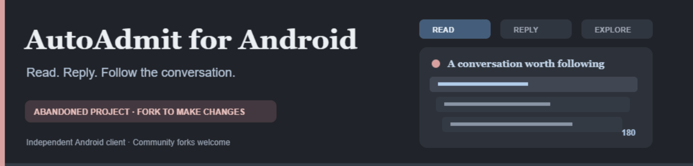
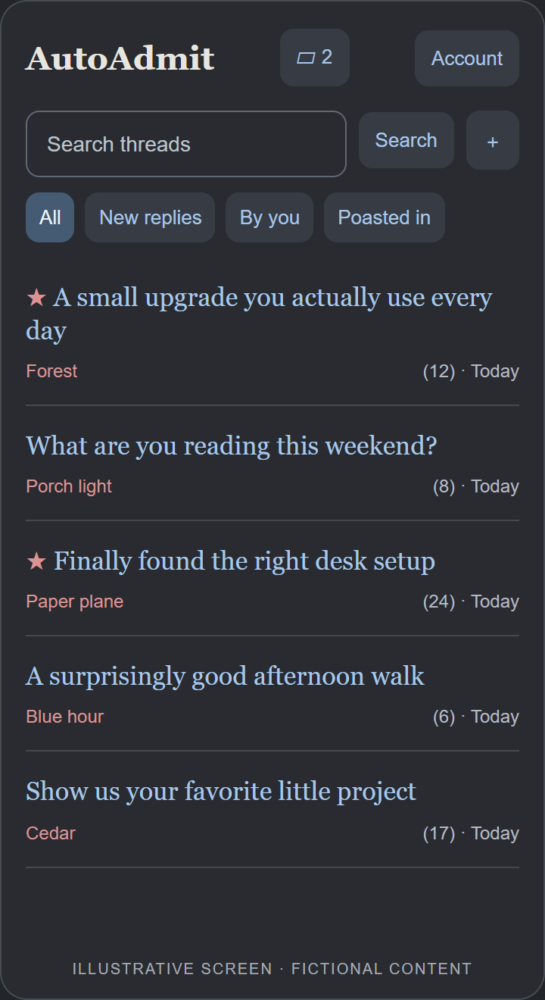
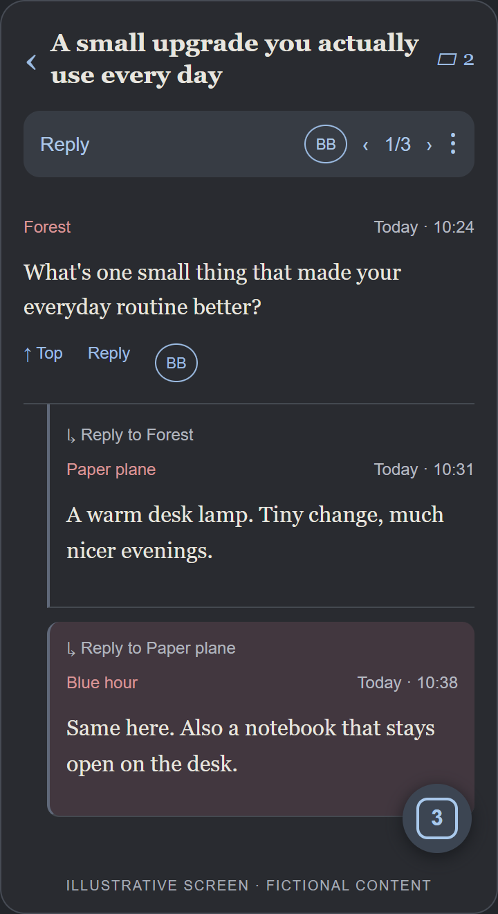
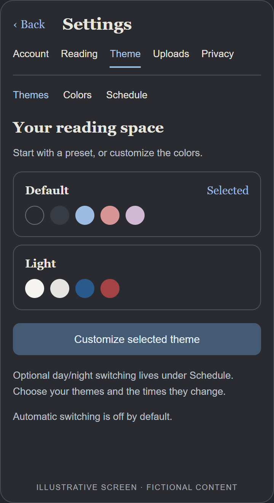

  

# AutoAdmit for Android

A native Android reader for AutoAdmit and XOXO: a compact thread view, replies you can follow, and links that open without losing your place.

> **This project is abandoned.** No maintenance, support, fixes, security updates or new releases are promised. If you want changes, **fork the repository and maintain your own version**. See [CONTRIBUTING](CONTRIBUTING.md) for development and build instructions.

[Download releases](../../releases) · [Getting started](#getting-started) · [What you can do](#what-you-can-do) · [For developers](CONTRIBUTING.md)

## A look around

<table>
  <tr>
    <td align="center"><strong>The board</strong> </td>
    <td align="center"><strong>Inside a thread</strong> </td>
    <td align="center"><strong>Make it yours</strong> </td>
  </tr>
</table>

*Illustrative screens with fictional content, not captures of anyone’s account or browsing activity. Appearance varies with your theme, Android version and text-size settings.*

## Getting started

Requires **Android 8.0 or later**. This is an unofficial app, distributed as an APK rather than through Google Play.

1. Open [Releases](../../releases) and download an attached `AutoAdmit.apk`. If there are no releases, no public APK has been published here yet.
2. Open the APK with Android’s **Package Installer**. If Android asks, allow installation from the browser or file manager you used.
3. Open the app, tap **Account**, choose the website and sign in with your website credentials. Signing in through a browser does not sign you into the app.
4. Saving your login and automatic sign-in are optional. Website sessions can still expire or be revoked.

**Updating an existing installation?** Install over the old version. Do not uninstall first: uninstalling or clearing app data removes locally stored accounts and settings. An update must use the same signing identity as the installed app.

## What you can do

| When you want to… | Use… |
| --- | --- |
| Browse or find a discussion | Search, **All**, **New replies**, **By you** and **Poasted in**. The ordinary board shows up to 30 threads after your filters. |
| Keep a few conversations open | Hold a thread title and choose **Open in new tab**. Ordinary taps do not save tabs. Open the tab selector to switch, swipe to close, or undo a close. Saved tabs restore after restarting. |
| Follow a thread | Read indented replies, jump to a parent, or enable **Nested cards** or **Stacked popovers** in Account → Reading. |
| Catch new replies | Watch for red stars on the board and a brief tint on newly detected replies. In a thread, the floating bubble shows how many unread replies remain; tap it to jump to the closest one. It disappears at zero. |
| Find your own posts | Use the ‹ count › controls in the thread header. Ownership depends on the website exposing an Edit link, not on matching a posting name. |
| Reply quickly | Tap **BB** for a blank bump. Hold it for sorted quick replies: `120`, `180`, `cq`, `cr`, `mfcr`, `ntcr`, `tcr`. These send immediately. |
| Search within a thread | Open **⋮ → Find in thread**. Search runs on the loaded post text. |
| View images and other links | Tap a supported link for a full-screen preview. **⋮ → Thread media** gathers supported media links in the thread. Long-press an external link for browser, preview and copy actions. |
| Share a particular reply | Hold a post’s date to copy its permalink. Hold a board title to copy the thread URL. |
| Hide something | Swipe left on the ordinary board to hide a thread, with Undo. In **New replies**, that gesture marks it read instead. Hidden threads expire after seven days, with a pool of the 30 most recently hidden. Manage them under Account → Privacy. |
| Manage your identities | Account → Accounts holds saved profiles and optional private nicknames. Account → Moniker changes your public posting name through the website. Optional phone-credential protection can hide saved accounts or lock the app. |
| Change the look | Account → Theme offers presets, color customization and an optional day/night schedule. Automatic switching is off by default. |

The app also includes an offline **Help** tab with instructions for its controls.

## Posting, editing and uploads

Use the compose button on the board to start a thread, or **Reply** inside a thread. Reply buttons on individual posts target those posts. Thread titles and optional post subjects are separate fields.

The upload icon accepts up to 20 JPEG, PNG, GIF or WebP images, up to 20 MB each. Configure your own **ImgBB API key** under Account → Uploads. Successful URLs are appended to the message and copied to the clipboard. Uploading an image does not submit your post. Video uploads are not supported.

**Images retain their embedded metadata.** Remove location or other sensitive metadata before uploading if you do not want to share it. Anyone with a hosted image URL may be able to view it.

If posting or editing cannot be confirmed, the app does not resend automatically. Check the board or thread before retrying, so you do not create duplicates.

## Updates and forks

Account → Updates accepts a public GitHub `owner/repository` or its HTTPS URL. The official public repository is selected by default. You can save a different public repository, or clear the source. **Use official repository** restores the default. The public repository name is visible in the APK; no GitHub email, password or token is included.

- **Check for updates** looks for the latest stable release.
- **Choose version** lists supported stable APK releases and their notes. Installed and older versions are labelled; only newer builds can be installed as updates.
- Downloads are checked for the expected package, newer Android version code and matching signing identity, plus a release checksum when supplied. Android asks you to approve installation.
- Checks run only when you request them. GitHub credentials are not needed for a public repository.

Because the project is abandoned, this updater is a convenience for releases that actually exist, **not a promise of future releases**. A community fork may use its own release source. A differently signed fork generally cannot update an existing installation in place.

## Privacy and limitations

Saved logins and cookies are encrypted on the device using Android Keystore. App backups are disabled. No developer-operated backend, analytics or embedded user credentials are included.

The websites, GitHub, image hosts and external preview providers still receive the requests needed for the features you use. This app does not make browsing anonymous. Do not share a working build folder, signing keys or account data with other people; share the release APK.

This app is not affiliated with or endorsed by AutoAdmit or XOXO. It relies on website HTML, so site changes can break login, posting or other features. Some previews require a browser, sign-in, verification or a subscription. The app does not bypass those requirements. Existing builds have incomplete live-site and device coverage; there is no guarantee that every provider or website form will continue working.

## License

[MIT](LICENSE). Third-party components retain their own licenses and credits; see [THIRD-PARTY-NOTICES](THIRD-PARTY-NOTICES.txt).

Want something changed? **Fork it and make it your own.** Development details live in [CONTRIBUTING](CONTRIBUTING.md).
